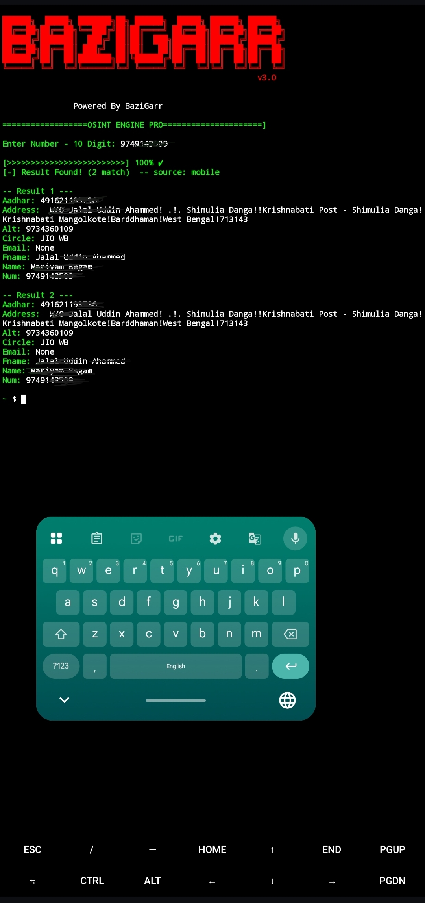

🕵️ BaziGarr OSINT Tool

<p align="center">
  
</p><h1 align="center">🕵️ BaziGarr OSINT Tool</h1><p align="center">
  <b>Advanced Mobile Number Information Lookup Tool</b>
  <br>
  Developed & Maintained by <b>BaziGarr</b>
</p><p align="center">
  
  
  
  
</p>---

⚡ About

BaziGarr OSINT Tool is a Python-based mobile number information lookup utility designed with a customized terminal interface.

The tool communicates with a configured API endpoint and displays the returned information in a structured and readable format.

Built with a custom BaziGarr ASCII banner, animated loading progress, colored terminal output, multiple-result handling, and Base64-encoded source code.

Designed for educational purposes and authorized OSINT research.

✨ Features

- 🔍 Mobile Number Information Lookup
- 🌐 API-Based Information Retrieval
- 📊 Multiple Result Handling
- 🎨 Custom Green Terminal Interface
- 🔴 BaziGarr Custom ASCII Banner
- ⚡ Animated Loading Progress Bar
- 📱 10-Digit Mobile Number Validation
- 🗂️ Structured Information Display
- 🔐 Base64-Encoded Source Payload
- 🐍 Python-Based Implementation
- 📟 Termux & Kali Linux Compatibility

---

📸 Tool Preview

<p align="center">
  
</p><p align="center">
  <i>BaziGarr OSINT Engine PRO — Terminal Preview</i>
</p>---

🛠️ Requirements

- Python 3.x
- Git
- Requests library
- Active API endpoint
- Valid API credentials
- Internet connection

---
## 🚀 Installation

### 📱 Method 1 — Termux Installation

**Step 1 — Update Packages**
```bash
pkg update && pkg upgrade -y
```

**Step 2 — Install Git & Python**
```bash
pkg install git python -y
```

**Step 3 — Clone Repository**
```bash
git clone [https://github.com/hckrr-bazigarr/Number-Information.git](https://github.com/hckrr-bazigarr/Number-Information.git)
```

**Step 4 — Navigate to Directory**
```bash
cd Number-Information
```

**Step 5 — Install Requirements**
```bash
pip install requests
```

**Step 6 — Run the Tool**
```bash
python3 num.py
```

---

### 🐉 Method 2 — Kali Linux Installation

**Step 1 — Update System**
```bash
sudo apt update && sudo apt upgrade -y
```

**Step 2 — Install Required Packages**
```bash
sudo apt install git python3 python3-pip python3-venv -y
```

**Step 3 — Clone Repository**
```bash
git clone [https://github.com/hckrr-bazigarr/Number-Information.git](https://github.com/hckrr-bazigarr/Number-Information.git)
```

**Step 4 — Navigate to Directory**
```bash
cd Number-Information
```

**Step 5 — Create Virtual Environment**
```bash
python3 -m venv venv
```

**Step 6 — Activate Virtual Environment**
```bash
source venv/bin/activate
```

**Step 7 — Install Requirements**
```bash
pip install requests
```

**Step 8 — Run the Tool**
```bash
python3 num.py
```

Virtual environment se bahar nikalne ke liye:
```bash
deactivate
```


«Note: Kali Linux uses a virtual environment to avoid the externally-managed-environment pip error.»

---

⚙️ API Configuration

The tool uses an external API endpoint to retrieve information.

Configure your authorized API credentials in the source code or through environment variables.

Example:

api_key = "YOUR_API_KEY"
base_url = "YOUR_API_ENDPOINT"

«Important: Never expose real API keys, private credentials, or sensitive endpoints in a public GitHub repository.»

---

🔐 Source Code Protection

The project uses Base64 encoding to store its Python source payload.

The encoded payload is decoded and executed at runtime.

Example:

decoded = base64.b64decode(_payload).decode("utf-8")
exec(decoded, globals())

Security Note: Base64 is encoding, not encryption. It does not prevent someone from recovering the original source code.

Never store confidential credentials inside the encoded payload.

---

📱 Supported Platforms

Platform| Compatibility
Android Termux| ✅
Kali Linux| ✅
Debian Linux| ✅
Ubuntu Linux| ✅
Windows| ✅

---

🖥️ How It Works

1. Launch the Python script.
2. Enter a valid 10-digit mobile number.
3. The tool validates the input.
4. The OSINT engine sends a request to the configured API.
5. The API response is processed.
6. Available results are displayed in the terminal.

---

⚠️ Disclaimer

This project is developed strictly for educational purposes and authorized OSINT research.

- Use only with proper authorization.
- Respect individual privacy and applicable data protection laws.
- Do not use this tool for stalking, harassment, or unauthorized surveillance.
- Do not misuse personal or confidential information.
- API results depend on the external service and may be inaccurate or incomplete.

The developer assumes no responsibility for unauthorized or illegal use of this software.

Use responsibly. Respect privacy. Stay ethical.

---

👨‍💻 Developer

<p align="center">
  <b>BAZIGARR</b>
  <br>
  OSINT | Python | Cybersecurity | Linux
  <br><br>
  <a href="https://github.com/hckrr-bazigarr">
    
  </a>
  <a href="https://www.instagram.com/hckr__bazigarr/">
    
  </a>
</p>
  

<p align="center">
  <b>⚡ POWERED BY BAZIGARR ⚡</b>
  <br>
  <i>Think Smart. Explore Responsibly.</i>
</p>
